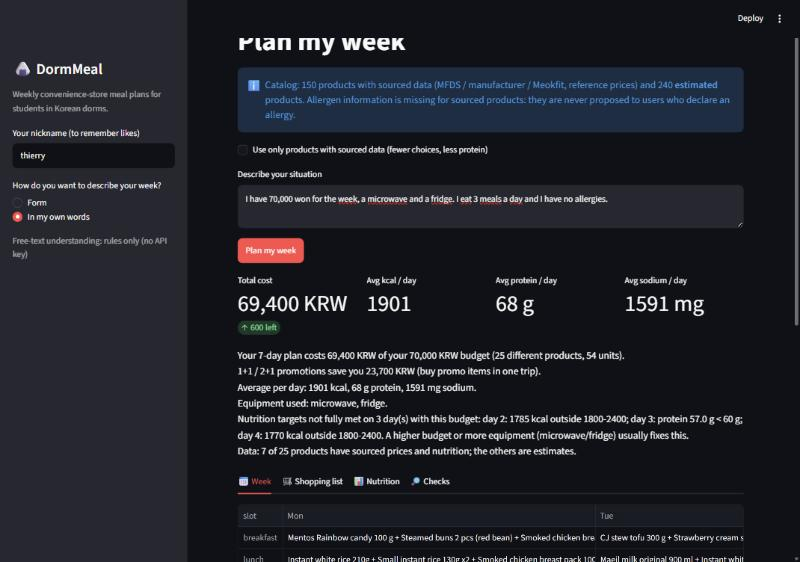
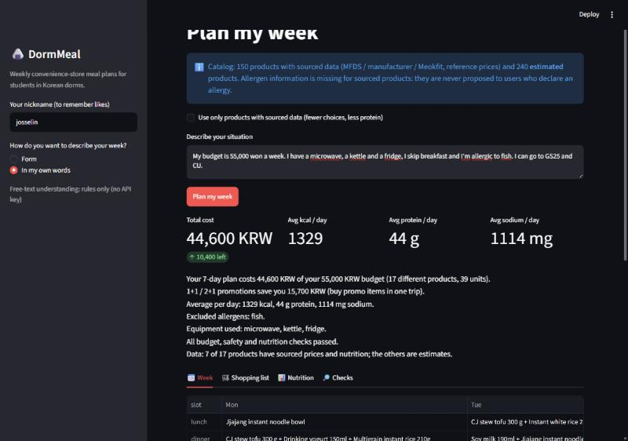
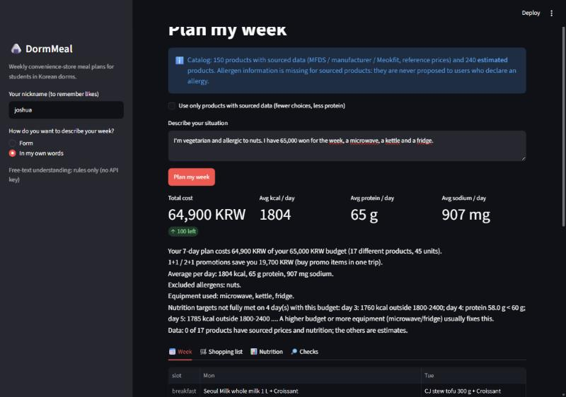
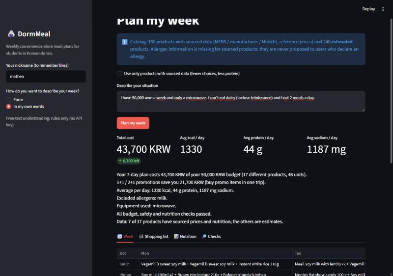
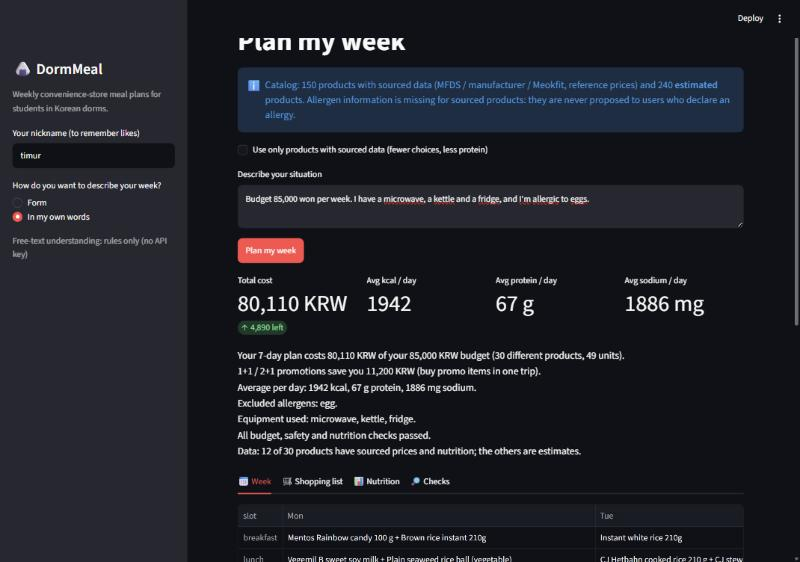

# Plans for five real student profiles

This document shows the plans DormMeal makes for five real students who live in Korean university dorms:
three at Hanyang University (two on the Seoul campus, one on the ERICA campus in Ansan), one at Kyungpook
National University (KNU), and myself. Each student gave me their real situation: weekly budget, equipment in
the dorm, allergies, diet and the stores they can reach.

I typed each profile in the running Streamlit app ("In my own words" mode, rule-based parser, no LLM key).
The Verifier checked every plan again after. Screenshots are in `docs/demo/`.

| Student | University | Budget | Cost | Meals/day | Excluded | Avg kcal | Avg protein | Avg sodium | All checks |
|---|---|---|---|---|---|---|---|---|---|
| Thierry Rosano | (author) | 70,000 | 69,400 | 3 | none | 1901 | 68 g | 1591 mg | no (3 days with nutrition gaps) |
| Josselin Tual | Hanyang, Seoul | 55,000 | 44,600 | 2 | fish | 1329 | 44 g | 1114 mg | yes |
| Joshua Hoorpah | Hanyang, Seoul | 65,000 | 64,900 | 3 | nuts, vegetarian | 1804 | 65 g | 907 mg | no (4 days with nutrition gaps) |
| Matheo Suhr | Hanyang ERICA, Ansan | 50,000 | 43,700 | 2 | milk | 1330 | 44 g | 1187 mg | yes |
| Timur Hasanov | KNU | 85,000 | 80,110 | 3 | egg | 1942 | 67 g | 1886 mg | yes |

For all five students the hard constraints are respected: budget, allergens, equipment, diet, stores and
variety. Two plans still miss the nutrition targets on some days, like in the benchmark.

**What I learned from these five profiles:**
- **Allergen bug found and fixed.** In the first version of these plans, Josselin (fish allergy) got a salmon
  kimbap and a tuna kimbap. The cause was the allergen inference script: it split the allergen list on commas,
  but the catalog uses semicolons, so 150 checked products lost their allergens and the inferred ones could not
  be read. I restored the data, added two tests that catch this problem, and made all five plans again.
- The rule-based parser did not understand "lactose intolerant". It only understands "lactose intolerance" or
  "can't eat dairy", so I had to write Matheo's request again.
- The app cannot handle a shellfish allergy: "fish" does not exclude shrimp, and there is no word for shellfish.
- Some meals are not realistic: plain instant rice alone, or Mentos candy with rice. The optimizer uses them
  because they give calories for a low price. A rule that limits snacks in one meal would fix this.
- The info banner in the app still says that sourced products have no allergen data. This is not true anymore.

## Feedback from the students

Each student looked at their own plan and gave me a score from 1 (bad) to 5 (very good) and their opinion.
The comments are their ideas, summarised in my own words.

| Student | Clarity | Trust | Usefulness | Would eat this week? | Comment |
|---|---:|---:|---:|---:|---|
| Josselin Tual | 5/5 | 4/5 | 4/5 | 5/5 | Honestly, this makes my life easier. Reassuring to have my fish allergy taken into account. A couple of odd combos, but overall really useful! |
| Joshua Hoorpah | 3/5 | 3/5 | 2/5 | 2/5 | Good idea, especially for students who are vegetarian and have allergies. I just wish there were more options. I wouldn't want to eat the same dishes all the time. |
| Matheo Suhr | 4/5 | 5/5 | 4/5 | 4/5 | Really useful on a student budget. I only have a microwave, so I love that I don't need to cook anything complicated. It also leaves some money in my pocket at the end of the week. Not every meal looks amazing, but I'd definitely use this again. |
| Timur Hasanov | 5/5 | 4/5 | 3/5 | 3/5 | Nice app and super convenient. I liked not having to worry about checking every product myself. With my budget, though, I'd hoped for a few more proper and balanced meal options. Still a good starting point. |
| **Average (4 students)** | **4.25** | **4.00** | **3.25** | **3.50** | |

My own opinion, as the author (not counted in the average): clarity 4/5, trust 4/5, usefulness 3/5, would eat
this week 3/5. Handy when you are busy, but some food combinations are strange; I would use it for ideas and
change some meals.

**What the feedback says.** Clarity (4.25) and trust (4.0) are good: the students like that their allergy and
budget are respected without checking every product. Usefulness (3.25) and "would eat this week" (3.5) are lower,
for the same reason as in my plan review: some meals are strange or repetitive. Joshua, the vegetarian student
with a nut allergy, gave the lowest scores because his plan has the least variety.

## Plan review

This is my own analysis of the five plans, based on the plan data. It is not the students' feedback (table above).
A "weak meal" is a meal with less than 8 g of protein, for example plain rice alone or candy.

| Student | Meals | Different products | Most repeated product | Budget used | Days with nutrition gaps | Weak meals |
|---|---|---|---|---|---|---|
| Thierry Rosano | 21 | 25 | Small instant rice 130g x4 | 99% | 3 | 3 |
| Josselin Tual | 14 | 17 | Drinking yogurt 150ml x4 | 81% | 0 | 1 |
| Joshua Hoorpah | 21 | 17 | Strawberry cream sandwich x6 | 100% | 4 | 3 |
| Matheo Suhr | 14 | 17 | Maeil soy milk with lentils x6 | 87% | 0 | 0 |
| Timur Hasanov | 21 | 30 | CJ stew tofu 300 g x5 | 94% | 0 | 6 |

- **Matheo** has the best plan: all checks pass, no weak meal, no dairy, and 6,300 KRW left with a small budget.
- **Josselin** passes every check and keeps 10,400 KRW. Only one dinner is weak (Mentos candy with a pork kimbap).
- **Timur** passes every check with the most variety (30 products), but the egg allergy removes many breakfast
  items: 6 of his meals are plain rice or candy, the most of all five.
- **Thierry** uses 99% of the budget and misses the targets on 3 days by a small amount; 3 meals are plain rice.
- **Joshua** is the hardest case: vegetarian with a nut allergy. The plan uses the full budget, has only 17
  products (strawberry cream sandwich 6 times), misses the targets on 4 days and has 3 meals of plain rice.

Main problem for the next version: on 4 of 5 plans the optimizer fills calories with plain rice or candy. A rule
like "every meal needs at least 10 g of protein" or "at most one snack per meal" would make the plans more realistic.

## Thierry Rosano

*French exchange student in Computer Science, fall semester in Seoul. Lives in a dorm with a shared microwave and fridge on his floor, no kitchen. Goes to the gym three times a week and wants more protein than his usual ramyeon-and-kimbap routine.*

**Request typed in the app:** "I have 70,000 won for the week, a microwave and a fridge. I eat 3 meals a day and I have no allergies."

**Parsed:** budget 70,000 KRW, 3 meals/day, equipment: microwave, fridge, allergies: none, diet: none, stores: CU, GS25, Emart24, 7-Eleven.

| Day | breakfast | lunch | dinner |
|---|---|---|---|
| Mon | Mentos Rainbow candy 100 g + Steamed buns 2 pcs (red bean) + Smoked chicken breast pack 100g | Instant white rice 210g + Small instant rice 130g x2 + Smoked chicken breast pack 100g | Beef bulgogi triangle kimbap |
| Tue | CJ stew tofu 300 g + Strawberry cream sandwich | Maeil milk original 900 ml + Instant white rice 210g | Instant white rice 210g |
| Wed | Mentos Rainbow candy 100 g + Beef bulgogi triangle kimbap x2 | Soy milk 190ml + Instant white rice 210g x2 + Chicken breast sausage | Soy milk 190ml + Instant white rice 210g |
| Thu | Brown rice instant 210g | CJ firm tofu 300 g + Brown rice instant 210g + Smoked chicken breast pack 100g | Welch's apple ade x2 + Spicy pork triangle kimbap + Brown rice instant 210g |
| Fri | Vegemil B sweet soy milk + Strawberry cream sandwich | Vegemil B sweet soy milk + CJ stew tofu 300 g + Instant white rice 210g | Spicy pork triangle kimbap + Strawberry cream sandwich x2 |
| Sat | Beef bulgogi triangle kimbap | Mentos Rainbow candy 100 g + Instant white rice 210g | Vegemil B sweet soy milk + CJ stew tofu 300 g x2 + Instant white rice 210g |
| Sun | Multigrain instant rice 210g + Chicken breast steak original | Wang Kkumteuri gummy worms + Multigrain instant rice 210g + Chicken breast steak original | Tuna mayo triangle kimbap + Chicken breast steak original + Small instant rice 130g x2 |

**Verifier notes:** day 2: 1785 kcal outside 1800-2400; day 3: protein 57.0 g < 60 g; day 4: 1770 kcal outside 1800-2400

## Josselin Tual

*Live in dorm like others, student who leaves early for lab sessions and never has time for breakfast.*
*That's  the same dorm of Thierry.*
*He is allergic to fish and seafood and mostly shops at the GS25 and CU near to campus.*

**Request typed in the app:** "My budget is 55,000 won a week. I have a microwave, a kettle and a fridge, I skip breakfast and I'm allergic to fish. I can go to GS25 and CU."

**Parsed:** budget 55,000 KRW, 2 meals/day, equipment: microwave, kettle, fridge, allergies: fish, diet: none, stores: CU, GS25.

| Day | lunch | dinner |
|---|---|---|
| Mon | Jjajang instant noodle bowl | CJ stew tofu 300 g + Drinking yogurt 150ml + Multigrain instant rice 210g |
| Tue | CJ stew tofu 300 g + Instant white rice 210g | Soy milk 190ml + Jjajang instant noodle bowl |
| Wed | Welch's grape ade + Wang Kkumteuri gummy worms + Instant white rice 210g | CJ stew tofu 300 g + Soy milk 190ml + Bulgogi triangle kimbap |
| Thu | Gochujang pork belly triangle kimbap + Seoul Milk whole milk 1 L | Ottogi cooked rice 210 g + Drinking yogurt 150ml x2 |
| Fri | Vegemil B sweet soy milk + Drinking yogurt 150ml + Bulgogi triangle kimbap | Mentos Rainbow candy 100 g + CJ firm tofu 300 g + Instant white rice 210g |
| Sat | CJ firm tofu 300 g + Instant white rice 210g + Soy milk 190ml x2 | Mentos Rainbow candy 100 g + Gochujang pork belly triangle kimbap |
| Sun | Welch's grape ade + Wang Kkumteuri gummy worms + Bulgogi triangle kimbap x2 | Welch's grape ade x2 + Ottogi cooked rice 210 g + CJ firm tofu 300 g |

**Verifier:** all checks passed (budget, allergens, equipment, diet, stores, variety, nutrition).

## Joshua Hoorpah

*Computor science major , vegetarian for several years, with a peanut allergy. Same dorm of others guys live in 7th dorm. Wants plans that are cheap but not the same rice ball every day.*

**Request typed in the app:** "I'm vegetarian and allergic to nuts. I have 65,000 won for the week, a microwave, a kettle and a fridge."

**Parsed:** budget 65,000 KRW, 3 meals/day, equipment: microwave, kettle, fridge, allergies: nuts, diet: vegetarian, stores: CU, GS25, Emart24, 7-Eleven.

| Day | breakfast | lunch | dinner |
|---|---|---|---|
| Mon | Seoul Milk whole milk 1 L + Croissant | Instant white rice 210g | CJ stew tofu 300 g + Instant white rice 210g |
| Tue | CJ stew tofu 300 g + Croissant | Instant white rice 210g x2 | CJ stew tofu 300 g + Soy milk 190ml + Instant white rice 210g |
| Wed | Brown rice instant 210g | CJ firm tofu 300 g + CJ stew tofu 300 g + Brown rice instant 210g | Strawberry cream sandwich x2 |
| Thu | Soy milk 190ml + Brown rice instant 210g | Seoul Milk whole milk 1 L + Vegetable triangle kimbap | Strawberry cream sandwich x2 |
| Fri | CJ stew tofu 300 g + Instant white rice 210g + Protein shake 330ml | Instant white rice 210g + Instant white rice 210g + Drinking yogurt 150ml | Instant white rice 210g |
| Sat | Instant white rice 210g + Small instant rice 130g | Protein shake 330ml + Vegetable triangle kimbap | Protein shake 330ml + Strawberry cream sandwich x2 |
| Sun | Seoul Milk whole milk 1 L + Small instant rice 130g | Greek yogurt cup + Drinking yogurt 150ml + Multigrain instant rice 210g | Greek yogurt cup + Vegetable triangle kimbap |

**Verifier notes:** day 3: 1760 kcal outside 1800-2400; day 4: protein 58.0 g < 60 g; day 5: 1785 kcal outside 1800-2400; day 6: 1625 kcal outside 1800-2400

## Matheo Suhr

*engineer student  on a tight budget. Lactose intolerant. Only has access to the microwave and eats two meals a day.*

**Request typed in the app:** "I have 50,000 won a week and only a microwave. I can't eat dairy (lactose intolerance) and I eat 2 meals a day."

**Parsed:** budget 50,000 KRW, 2 meals/day, equipment: microwave, allergies: milk, diet: none, stores: CU, GS25, Emart24, 7-Eleven.

| Day | lunch | dinner |
|---|---|---|
| Mon | Vegemil B sweet soy milk + Vegemil B sweet soy milk + Instant white rice 210g | Soy milk 190ml x2 + Brown rice instant 210g + Bulgogi triangle kimbap |
| Tue | Maeil soy milk with lentils x2 + Vegemil B sweet soy milk + Instant white rice 210g | Mentos Rainbow candy 100 g + Soy milk 190ml + Beef bulgogi triangle kimbap |
| Wed | Maeil soy milk with lentils x2 + Vegemil B sweet soy milk + Instant white rice 210g | Mentos Rainbow candy 100 g + Vegemil B sweet soy milk + Beef bulgogi triangle kimbap |
| Thu | Maeil soy milk with lentils x2 + Vegemil B sweet soy milk + Instant white rice 210g | Mentos Rainbow candy 100 g + Spicy pork triangle kimbap + Unsweetened soy milk 190ml |
| Fri | Spicy pork triangle kimbap + Soy milk 190ml + Soy milk 190ml | Instant white rice 210g x2 + Unsweetened soy milk 190ml x2 |
| Sat | Vegemil B sweet soy milk + Bulgogi triangle kimbap + Soy milk 190ml | Brown rice instant 210g x2 + Black soybean soy milk 190ml + Soy milk 190ml |
| Sun | Sweet and sour pork box (dipping sauce) | Instant white rice 210g + Black soybean soy milk 190ml x2 |

**Verifier:** all checks passed (budget, allergens, equipment, diet, stores, variety, nutrition).

## Timur Hasanov

*Graduate student in electronics, i have a larger budget. Allergic to eggs. Has a microwave, a kettle and a fridge in a shared kitchen corner and shops at any of the four chains.*

**Request typed in the app:** "Budget 85,000 won per week. I have a microwave, a kettle and a fridge, and I'm allergic to eggs."

**Parsed:** budget 85,000 KRW, 3 meals/day, equipment: microwave, kettle, fridge, allergies: egg, diet: none, stores: CU, GS25, Emart24, 7-Eleven.

| Day | breakfast | lunch | dinner |
|---|---|---|---|
| Mon | Mentos Rainbow candy 100 g + Brown rice instant 210g | Vegemil B sweet soy milk + Plain seaweed rice ball (vegetable) | CJ stew tofu 300 g x2 + Apple single + Steamed buns 2 pcs (red bean) |
| Tue | Instant white rice 210g | CJ Hetbahn cooked rice 210 g + CJ stew tofu 300 g x2 | Cantata premium latte + Maxim T.O.P master latte 275 ml + Samyang Ramen (single bag) |
| Wed | Oronamin C vitamin drink x2 + Vegemil B sweet soy milk + Steamed buns 2 pcs (red bean) | Sweet and sour pork box (dipping sauce) + Binggrae The:Danbaek protein drink chocolate 250 ml | Welch's grape ade + Oronamin C vitamin drink + Spicy pork triangle kimbap |
| Thu | CJ firm tofu 300 g + Jeonju bibimbap triangle kimbap + Brown rice instant 210g | Instant white rice 210g | CJ firm tofu 300 g + Jjajang instant noodle bowl |
| Fri | CJ firm tofu 300 g + Jjajang instant noodle bowl | Mentos Rainbow candy 100 g + Instant white rice 210g | CJ stew tofu 300 g + Spicy pork triangle kimbap |
| Sat | Sweet and sour pork box (dipping sauce) | CJ stew tofu 300 g + Instant white rice 210g | Vegemil B sweet soy milk + Hetbahn Cupbahn spicy pork rice bowl |
| Sun | Brown rice instant 210g | Wang Kkumteuri gummy worms + Greek yogurt cup x2 + Instant white rice 210g | Welch's grape ade + Nongshim Neoguri udon ramen (single bag) + CJ stew tofu 300 g |

**Verifier:** all checks passed (budget, allergens, equipment, diet, stores, variety, nutrition).
